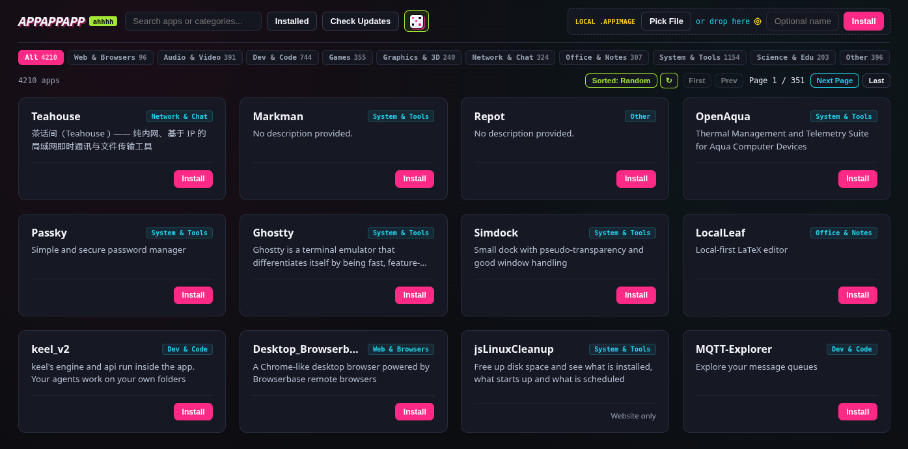

cd ~/ahhhh
cat << 'EOF' > README.md
<div align="center">

# `ahhhh` // AppAppApp

**A fast, zero-bloat Linux AppImage workbench with a punk DIY web UI.**

Browse 4,200+ AppImages, roll a die when you're bored, drag-and-drop local `.AppImage` files, and wire them cleanly into your desktop menu—all from one single Go binary.

[](https://github.com/pink-blancmange/ahhhh/releases)
[](LICENSE)
[](https://github.com/pink-blancmange/ahhhh/releases)

<br />



</div>

---

## Install

### Quick One-Liner

```bash
curl -fsSL https://raw.githubusercontent.com/pink-blancmange/ahhhh/main/install.sh | bash
```

### Packages & Archives

Grab the `.deb` (`amd64` / `arm64`) or `.tar.gz` releases from the [**Releases**](https://github.com/pink-blancmange/ahhhh/releases) tab:

```bash
sudo dpkg -i ahhhh_*_amd64.deb
```

---

## Supported Systems & Requirements

* **Architectures:** `x86_64` (`amd64`) and `aarch64` (`arm64`).
* **Distros:** Standard `glibc` desktop Linux distros with writable `/opt` and `/usr/local/bin` (Debian, Ubuntu, Linux Mint, MX Linux, Pop!_OS, Fedora, Arch, openSUSE). Read-only/immutable root distros (Silverblue, SteamOS, NixOS) and `musl` distros (Alpine) aren't supported out of the box.
* **Runtime needs:** `pkexec` (Polkit) for GUI system-wide installs/removals, FUSE (`libfuse2` / `libfuse2t64` or `fuse3`) to extract metadata and run Type-2 AppImages, and a browser (`xdg-open`) for the web UI (CLI works headless).

---

## Why `ahhhh`?

* **Single binary, zero bloat** — Go backend with the web UI embedded inside. Runs on `127.0.0.1:8745` and opens your browser.
* **Desktop integration** — Installs AppImages into `/opt/appimages/`, symlinks into `/usr/local/bin/`, pulls icons, and adds `.desktop` launchers.
* **Local `.AppImage` drop** — Drop a local `.AppImage` onto the target box, optionally name it, and extract its metadata/icon automatically.
* **Richer app details** — Pulls AppStream XML descriptions, `.desktop` comments, GitHub repo topics, and latest release notes in the inspector modal.
* **Dice roller** — Roll 1–6 random installable apps from the catalog or active category crate.
* **CLI ready** — Run headless commands straight from the terminal.

---

## Usage

```bash
ahhhh                             # Launch the web workbench
ahhhh list                        # List installed system-wide AppImages
ahhhh install <app-name>          # Install an app from the catalog
ahhhh install ./MyTool.AppImage   # Install a local .AppImage
ahhhh update                      # Update GitHub-tracked AppImages
ahhhh remove <app-name>           # Remove binary, icon, symlink & launcher
```

---

## Build from Source

```bash
git clone https://github.com/pink-blancmange/ahhhh.git
cd ahhhh
go build -o ahhhh .
./ahhhh
```

---

## Uninstall

* **`.deb` install:** `sudo apt remove ahhhh`
* **`install.sh` install:** `sudo rm -f /usr/local/bin/ahhhh ~/.local/share/applications/ahhhh.desktop`

---

<div align="center">

**GPL-3.0-or-later** · [**pink-blancmange**](https://github.com/pink-blancmange)

</div>
EOF

